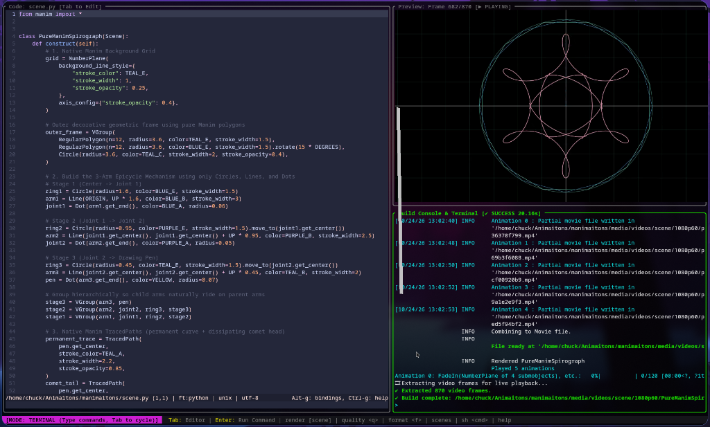
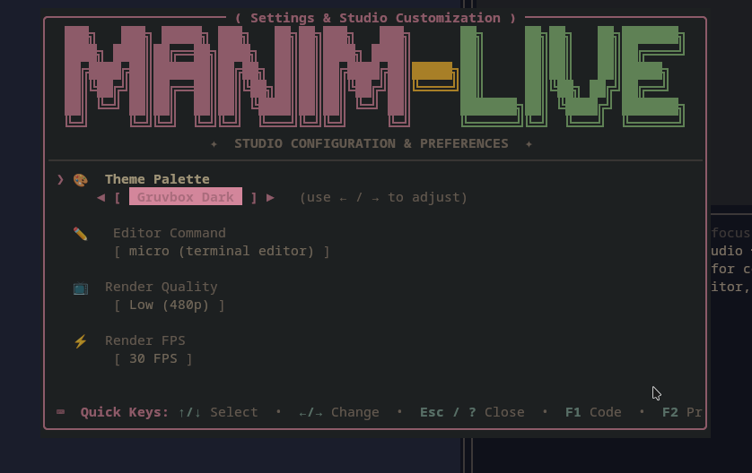

<p align="center">
  
</p>

<p align="center">
  <strong>Interactive TUI live-reloading studio for Python's Manim animation engine.</strong>
</p>

<p align="center">
  <a href="#quick-install"></a>
  <a href="https://github.com/manim-live/manim-live/releases"></a>
  <a href="https://rust-lang.org"></a>
  <a href="https://www.manim.community/"></a>
  <a href="LICENSE"></a>
</p>

---

## 🎬 Overview

**`manim-live`** transforms the Manim math animation workflow into an instantaneous, IDE-like terminal experience:

- **Edit on the left**: Write Python scene code with your favorite terminal editor (`micro`, `vim`, `nvim`, or `nano`) inside a built-in virtual terminal pane.
- **Watch on the right**: Automatically recompiles upon save and plays full 60 FPS animation previews using the Kitty Graphics Protocol or unicode halfblocks.
- **Scrub & inspect**: Pause, seek, step frame-by-frame, switch scenes with fuzzy search, or adjust resolution and frame rates on the fly.

<p align="center">
  
</p>

---

## ✨ Features

- ⚡ **Instant Startup & Live Auto-Reload**
  Spawns in under 5ms. Listens to file changes and triggers background builds upon save without locking your editor.
- 📺 **High-Performance Terminal Video Playback**
  Zero-flicker native terminal graphics rendering via DECSET synchronized updates. Supports 15–120 FPS playback with automatic Kitty / Halfblocks protocol detection.
- 🎛️ **Timeline Scrubber & Frame Stepping**
  Play/pause with `Space`, step frame-by-frame with `←` / `→`, jump ±10% with `Shift+←/→`, or drag the interactive timeline scrubber with your mouse.
- 🔍 **Scene Palette (`F8` / `Ctrl+P`)**
  Instantly discover and switch between scenes defined in your Python file via fuzzy search.
- 🎨 **Studio Settings & Theme Palettes (`?` / `F4`)**
  Toggle the studio modal to adjust render quality (480p to 4K), frame rates, default editor, or theme palettes (Catppuccin Mocha, Gruvbox Dark, Tokyo Night, Nord, Dracula, High Contrast).
- 💾 **Cross-Session Persistence**
  Remembers your preferred quality, frame rates, and theme across sessions and files.

<p align="center">
  
</p>

---

## 🚀 Quick Install

### One-Line Automated Setup (Recommended)

The automated installer detects your system, installs required packages (`ffmpeg`, `micro`, `manim`, `rust`), compiles, and puts `manim-live` in your `PATH`:

```bash
curl -fsSL https://raw.githubusercontent.com/manim-live/manim-live/main/install.sh | bash
```

### Build From Source

```bash
# 1. Clone the repository
git clone https://github.com/manim-live/manim-live.git
cd manim-live

# 2. Run the dependency installer & build script
./install.sh
```

Or build manually with Cargo:

```bash
cargo build --release
install -m 755 target/release/manim-live ~/.local/bin/manim-live
```

---

## 💻 Usage

```bash
# Launch live studio on a Python file
manim-live scene.py

# Launch focused on a specific Scene class
manim-live scene.py MyAnimatedCircle

# Set initial preview quality and FPS cap
manim-live scene.py --quality high --fps 60

# Choose your preferred embedded editor
manim-live scene.py --editor nvim
```

### Command-Line Options

| Option | Description | Default |
|---|---|---|
| `<FILE>` | Python file containing Manim scene definitions | *Required* |
| `[SCENE]` | Optional specific Scene class name to render | First detected |
| `-q, --quality <QUALITY>` | Render quality (`low` 480p, `medium` 720p, `high` 1080p, `4k` 2160p) | `low` |
| `--fps <FPS>` | Frame rate cap for live animation previews | `30` |
| `-e, --editor <EDITOR>` | Preferred terminal editor (`micro`, `vim`, `nvim`, `nano`) | `micro` |
| `--protocol <PROTOCOL>` | Image rendering protocol (`auto`, `kitty`, `halfblocks`) | `auto` |
| `--manim <PATH>` | Custom path or binary executable for Manim | System PATH / venv |

---

## ⌨️ Hotkeys & Shortcuts

### Workspace Navigation
| Key | Action |
|---|---|
| `F1` / `Ctrl+1` | Focus **Code Editor** pane |
| `F2` / `Ctrl+2` | Focus **Live Preview** pane |
| `F3` / `Ctrl+3` | Focus **Build Console** pane |
| `Tab` | Cycle focus between panes |
| `Ctrl+Q` | Quit studio |

### Animation Preview & Scrubbing
| Key | Action |
|---|---|
| `Space` | Play / Pause animation |
| `←` / `→` | Step 1 frame backward / forward |
| `Shift + ←` / `Shift + →` | Seek -10% / +10% |
| `[` / `]` | Decrease / Increase playback speed (0.5x – 2.0x) |
| `f` / `F11` | Toggle fullscreen preview |
| `r` / `F5` | Trigger manual full animation rebuild |
| `Mouse Drag` | Scrub timeline track or adjust pane splits |

### Studio Customization
| Key | Action |
|---|---|
| `?` / `F4` | Toggle **Studio Settings** overlay |
| `F8` / `Ctrl+P` | Open **Scene Palette** (fuzzy scene switcher) |
| `↑` / `↓` | Select setting row |
| `←` / `→` | Cycle themes, editors, qualities, or FPS |
| `Esc` | Close overlay / exit fullscreen |

---

## 📋 Requirements

- **Linux** or **macOS**
- **[FFmpeg](https://ffmpeg.org/)** (required for video frame extraction)
- **[Python 3.9+](https://python.org/)** with **[Manim Community](https://www.manim.community/)** installed
- **Terminal with Kitty Graphics Protocol** (recommended for full 60 FPS: Kitty, Alacritty, Ghostty, WezTerm, iTerm2). Automatically falls back to Unicode halfblocks on other terminals.

---

## 📄 License

Licensed under the [MIT License](LICENSE).
